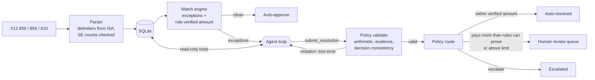

# ThreeWay

**An AI agent that resolves accounts-payable invoice exceptions from EDI, with deterministic guardrails and a human in the loop.**

[](https://github.com/FaranMustafa/threeway-agent/actions/workflows/ci.yml)
  

## The problem

Before a company pays a supplier, accounts payable runs a **three-way match**: does the invoice (EDI **810**) agree with the purchase order (**850**) and with what actually arrived (the dock's receiving log and the vendor's ship notice, **856**)?

Most invoices match. The rest become *exceptions*, and a person works through them by hand: pulling up the PO, reading receiving notes, checking contract amendments, emailing the vendor. Rules engines catch the mismatch but cannot settle it. They short-pay a legitimate price increase, pay for goods the dock rejected in a free-text note, and send every off-PO line to a queue.

ThreeWay keeps the rules for what rules do well: parsing, matching, arithmetic, limits. It hands the judgment to an agent. The agent investigates with read-only tools, proposes a resolution with cited evidence, and deterministic policy decides whether that resolution posts automatically or waits for a person.

## How it works



1. **Parse.** A strict X12 reader takes element and segment delimiters from the ISA header, checks `SE01` segment counts and ST/SE control numbers, and parses POs, ship notices (including substitute-part lines) and invoices. Money is integer cents end to end.
2. **Match.** A deterministic engine flags price variance (with per-vendor tolerance), quantity not received, quantity over ordered, unknown items, unit-of-measure mismatches, receiving notes and likely duplicates. It also computes the **rule-verified amount**, the most the records can prove is owed.
3. **Investigate.** For any invoice with exceptions, the agent calls tools: `get_invoice`, `get_purchase_order`, `get_ship_notices`, `get_receiving_log`, `get_contract_price`, `get_vendor_profile`, `find_related_invoices`. It finishes by calling `submit_resolution` with a decision, an amount, line-level adjustments, the tool-call ids it relied on, and a draft note to the vendor.
4. **Validate.** Hard rules run on every submission. Is the arithmetic exact? Is the decision consistent with the amount? Do the adjustments name SKUs that are on the invoice? Was a duplicate actually detected? Does every cited piece of evidence match a tool call that really ran? A violation goes back to the agent as a tool error, so it can correct itself.
5. **Route.** A valid resolution posts automatically only if it pays no more than the rule-verified amount and stays under the auto-approve limit. The agent may *recommend* paying more (an approved substitute part, a cases-vs-eaches billing difference), but only a person can approve that. Every case stores its full trace: each model turn, tool call, tool result, policy rejection and routing reason.

## Evaluation

`evals/labels.json` holds ten labeled scenarios drawn from real AP exception types. The baseline planner encodes the rule most AP automation ships with: pay the lesser of ordered and received quantity at the PO price, and escalate anything off-PO.

| Invoice | Scenario | Correct outcome | Rules baseline |
|---|---|---|---|
| INV-1001 | clean match | approve $2,400.00 | ✓ |
| INV-1002 | price raised by a contract amendment after the PO | approve $860.00 | ✗ short-pays $60 |
| INV-1003 | price above PO and contract | adjust to $1,000.00 | ✓ |
| INV-1004 | short shipment | adjust to $860.00 | ✓ |
| INV-1005 | 6 damaged units, recorded only in a dock note | adjust to $1,320.00 | ✗ overpays $180 |
| INV-1006 | freight billed against prepaid-freight terms | adjust to $300.00 | ✗ escalates |
| INV-1007 | duplicate of INV-1004 under a new number | reject | ✓ |
| INV-1008 | approved substitute part | approve $540.00 → human | ✗ escalates |
| INV-1009 | billed per each, ordered per case | approve $1,200.00 → human | ✗ short-pays $1,100 |
| INV-1010 | invoice against an unknown PO | escalate | ✓ |

The baseline scores **5/10**, overpays **$180** and underpays **$1,160**. Those are the cases where judgment and context matter. Run the same eval against the agent:

```bash
uv run threeway eval --planner baseline          # offline, runs in CI
uv run threeway eval --planner claude --out reports/claude.json
```

The report includes decision accuracy, routing accuracy, dollars overpaid and underpaid, needless escalations, token usage and estimated cost.

## Quickstart

```bash
uv sync
uv run threeway seed                       # sample master data + EDI into threeway.db
uv run threeway investigate INV-1005 --planner baseline
export ANTHROPIC_API_KEY=...               # or `ant auth login`
uv run threeway investigate INV-1009 --planner claude --trace
uv run threeway serve                      # http://localhost:8000/docs
```

Or with Docker:

```bash
docker build -t threeway . && docker run -p 8000:8000 -e ANTHROPIC_API_KEY threeway
```

### API

| Method | Path | Purpose |
|---|---|---|
| `POST` | `/edi` | Ingest an X12 interchange (`text/plain`). Invoices are matched on arrival. |
| `GET` | `/invoices/{n}/match` | Exceptions and rule-verified amount |
| `POST` | `/invoices/{n}/investigate?planner=claude` | Run the agent; returns the case with its trace |
| `GET` | `/cases?status=awaiting_human` | Review queue |
| `GET` | `/cases/{id}` | Case with the full trace |
| `POST` | `/cases/{id}/review` | A person approves or rejects (`409` if not awaiting review) |

## Design decisions

- **The LLM never does the arithmetic that matters.** Matching, the rule-verified amount and resolution consistency are deterministic. The model decides *what* is owed and *why*; code checks that the numbers add up.
- **Guardrails talk back to the agent.** A policy violation comes back as an `is_error` tool result, not an exception, so the agent fixes its own mistake. After three rejected submissions the case escalates.
- **Evidence must be real.** Cited evidence must match tool calls that actually ran in that case, which catches made-up justifications.
- **Autonomy is bounded by money, not by confidence scores.** The agent can lower a payment on its own when the evidence supports it. Paying more than the records prove always needs a person.
- **Model choice and request settings.** Claude Opus 5.5 with adaptive thinking, `effort: high`, strict tool schemas, prompt caching across loop turns, and server-side refusal fallback (`fallbacks: "default"`). History is append-only, so thinking blocks go back unchanged. Forced `tool_choice` is unavailable on this model, so the prompt and the loop's nudge make sure the run ends with `submit_resolution`.
- **Planners are pluggable.** The rules baseline and Claude run through the same loop, tools and policy, so the eval compares them like for like, and the test suite drives the loop with scripted planners and no network.

## Project layout

```
src/threeway/
  edi/x12.py        X12 tokenizer + 850/856/810 parsers
  edi/builder.py    builds valid interchanges (samples, tests)
  matching.py       three-way match engine
  agent/tools.py    tool schemas + read-only toolbox
  agent/policy.py   validate() and route() guardrails
  agent/planners.py ClaudePlanner, BaselinePlanner
  agent/runner.py   the agent loop and trace
  api.py            FastAPI service
  evals.py          scenario scoring
data/               master data + sample EDI (regenerate: scripts/generate_samples.py)
evals/labels.json   labeled scenarios
tests/              parser, matcher, policy, loop, planner request shape, API, eval
```

## Roadmap

- Postgres and a background worker queue for large invoice batches
- Remittance (820) and invoice-accepted acknowledgements (997) back to the vendor
- Vendor email drafting through an outbox with approval
- More scenarios: partial invoicing across multiple ASNs, currency, tax lines

## License

MIT
